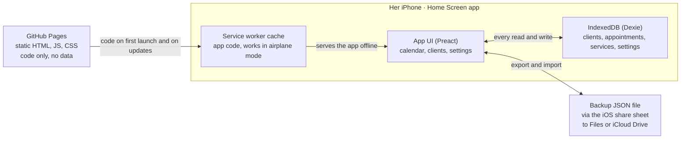

# Kirpėjos užrašų knygelė – App Spec

Spec date: 2026-10-13 · Owner: Tomas

## Purpose and hard constraints

A Lithuanian-language Home Screen web app replaces a hairdresser's paper appointment book. All data stays on her iPhone. One user, one device, no backend.

| Constraint | Rule |
| --- | --- |
| Language | Every visible string is Lithuanian (lt-LT): labels, dates, weekdays, toasts, errors, empty states. 24-hour time. Week starts Monday. |
| Platform | Home Screen web app on iPhone, opened from its icon in standalone mode. No App Store, no Apple Developer account. |
| Hosting | Static files on GitHub Pages. GitHub serves code only and never receives data. |
| Data | IndexedDB on the phone. No server, no analytics, no third-party requests at runtime (no CDN fonts or scripts). |
| Typing | The client name is the only free-text input when booking. Service, date and time are picked. |
| Time | Only the start time is recorded and shown. The user never enters or sees an end time. |
| Speed | A new booking takes at most 3 taps plus typing the name. |
| Look | Feels like a native iOS app (see [iOS look and feel](#ios-look-and-feel)). |

## Platform, hosting and storage

A static PWA built from a GitHub repo and served by GitHub Pages. After the first load a service worker serves the code from cache, and all reads and writes go to IndexedDB on the phone.

GitHub delivers only code. The backup file is the only copy of the data that ever exists off the phone. Nothing flows back to GitHub.

| Component | Choice | Reason |
| --- | --- | --- |
| Build | Vite + TypeScript | Static output that Pages can serve |
| UI | Preact | Small bundle, plain component model |
| Storage | Dexie.js over IndexedDB | Versioned schema with upgrade functions |
| Offline | vite-plugin-pwa (Workbox precache) | App opens in airplane mode |
| Dates | Native `Intl` with `lt-LT` | Lithuanian weekdays and months with no date library |
| Deploy | GitHub Actions to Pages on push to `main` | One-step release |

Rules:

- **Fixed origin and path.** The app lives at `https://flashuu1.github.io/darbo-knyga/` (GitHub Pages project site, repo `flashuu1/darbo-knyga`). The origin `https://flashuu1.github.io` and the path `/darbo-knyga/` are permanent: storage is tied to the origin, so moving the app, renaming the repo or changing the path strands her data. Storage is per origin, not per path, so any other site on the `flashuu1` account shares this origin: the IndexedDB database name must stay unique (the app uses `vizitai`) and no other site may touch it. The production build uses `base: '/darbo-knyga/'` (`site.config.json`, the single source of truth; `scripts/scan-bundle.mjs` fails if `dist/` disagrees); the manifest `start_url`/`scope`, service-worker scope and precache URLs all derive from it. Dev and the e2e build use `/`.
- **Standalone only.** If the app is opened in a Safari tab, it shows only the install screen and never writes data. The Home Screen app's storage is treated as separate from Safari's.
- **Persistence.** Call `navigator.storage.persist()` on the first standalone launch and show the result in Settings.
- **Local wall-clock times.** Store `start` as `YYYY-MM-DDTHH:mm` local time and never convert it to UTC. The DST change on 2026-10-25 must not shift any appointment.
- **Schema changes.** Only through Dexie version upgrades that migrate the data. Never drop a store.
- **Updates.** A new code version activates on the next launch, never while a sheet is open.
- **Backup.** Export all data as one JSON file that includes `schemaVersion`. Share it through the iOS share sheet (`navigator.share` with a file) to Files or iCloud Drive. Import restores it from a file picker.
- **Out of scope:** reminder notifications (need a push server), access to iOS Contacts or Calendar, haptics (iOS Safari has no Vibration API).

## Data model

The app stores four record types. Clients are created automatically from the typed name, so a separate contact form is never needed.

**`clients`**

| Field | Type | Notes |
| --- | --- | --- |
| `id` | string (UUID) | Primary key |
| `name` | string | As typed, trimmed, single spaces |
| `nameKey` | string, indexed | Lowercase with diacritics removed (`NFD`, strip marks): "Žydrūnė" becomes "zydrune" |
| `phone` | string, optional | Added later from the client card, never during booking |
| `createdAt`, `updatedAt` | ISO timestamp | |

**`appointments`**

| Field | Type | Notes |
| --- | --- | --- |
| `id` | string (UUID) | Primary key |
| `kind` | `client` \| `personal` | Personal = her own appointments |
| `clientId` | string, nullable, indexed | Null when `kind = personal` |
| `title` | string, nullable | Typed text for personal entries only |
| `serviceId` | string, nullable | Null when `kind = personal` |
| `start` | string `YYYY-MM-DDTHH:mm`, indexed | Local wall-clock time, snapped to the 15-minute grid |
| `status` | `booked` \| `cancelled` \| `noshow` | "Done" is derived: `booked` with a start in the past |
| `cancelReason` | string, nullable | One of the preset reasons or null |
| `cancelledAt` | ISO timestamp, nullable | |
| `moves` | array of `{at, from, to}` | Reschedule history, appended on every move |
| `createdAt`, `updatedAt` | ISO timestamp | |

**`services`**: `id`, `name`, `color` (iOS system colour name), `minutes` (hidden default length), `order`, `active`. Removing a service sets `active = false` so old appointments keep their label.

**`settings`** (one record): `dayStart` (08:00), `dayEnd` (20:00), `slotMinutes` (15), `lastBackupAt`, `persistGranted`.

Logic rules:

1. On save, look up the typed name by `nameKey`. If it matches, link the existing client; if not, create a new client.
2. The service's `minutes` is used only to size the block in the calendar and to detect overlaps. It never appears in a booking form (it is edited only in Settings).
3. An overlap means another `booked` appointment whose `[start, start + minutes)` intersects the new one. Overlaps warn but never block the save.
4. Search compares `nameKey` with the folded query. `localeCompare` cannot be used here: under `lt` rules "Z" and "Ž" are different letters.
5. Client lists sort with `Intl.Collator('lt')`.

## Screens and navigation

The app opens on today's day view. A bottom tab bar has three tabs: Kalendorius, Klientai, Nustatymai.

| Screen | Contents | Main gestures |
| --- | --- | --- |
| Calendar – Day (default) | Large title with the date ("spalio 14 d., trečiadienis"). Week strip of 7 day chips, with a dot on days that have bookings. Vertical timeline from `dayStart` to `dayEnd` with 15-minute rows. Each entry shows start time, client name and service, coloured by service. | Swipe left or right to change day. Tap an empty row to book there. Tap an entry to open it. Long-press an entry to move it. "Šiandien" button jumps to today. |
| Calendar – Week | Segmented control "Diena \| Savaitė". Seven columns with compact entries (time + name). | Same as Day. Dragging an entry across columns changes its date. |
| Calendar – Month | Opened by tapping the month name. Month grid with a booking count per day. | Tap a day to open its Day view. |
| Appointment sheet | Bottom sheet: name, service, date and time, status, actions. | See [Open, reschedule and cancel](#open-reschedule-and-cancel). |
| New appointment sheet | Bottom sheet, see [Add appointment flow](#add-appointment-flow). | Opened by "+" in the nav bar or by tapping an empty row. |
| Clients | Search field and alphabetical list (`Intl.Collator('lt')`) with the last visit date under each name. | Tap a client to open the card. |
| Client card | Name (editable), optional phone, upcoming visits, past visits, visit count, cancellation and no-show count. "Registruoti" button. | "Registruoti" opens the new appointment sheet with the client filled in. |
| Settings | Services (add, rename, reorder, colour, length in minutes, hide), working hours, backup export and import, storage status, app version. | |
| Install screen | Shown only when the app is opened in a Safari tab: steps to add it to the Home Screen. | |

## Add appointment flow

Target: tap an empty slot, type the name, tap a service, tap Save. Every other value comes prefilled.

The sheet ("Naujas vizitas") has four rows, top to bottom:

1. **Type.** Segmented control "Klientas | Asmeninis", defaulting to Klientas.
2. **Name.** Autofocused text field, keyboard open. While it is empty, it lists the most recent clients. While typing, it lists matching clients from a diacritic-insensitive `nameKey` search. At most 3 suggestions are shown, so the service chips stay reachable above the keyboard. A tap outside the sheet while a name is typed only hides the keyboard; "Atšaukti" closes the sheet. Tapping a match fills the field and links that client. For Asmeninis entries this field becomes "Pavadinimas".
3. **Service.** One row of chips, single select. The default is the linked client's last service, otherwise the first service in the list. Hidden for Asmeninis.
4. **Time.** One row showing the prefilled date and time, for example "spalio 14 d., tr · 10:30". Tapping it opens the native iOS date and time wheels in 15-minute steps.

The nav bar has "Atšaukti" on the left and "Išsaugoti" on the right. "Išsaugoti" is disabled until the name is not empty.

Prefill rules:

- Opened by tapping an empty row: that row's date and time.
- Opened by "+": the selected day and the next free 15-minute slot after now (on today), or `dayStart` (on other days).
- Opened from a client card: that client and their last service.

On save:

1. Match or create the client (data model rule 1).
2. If the new entry overlaps an existing booking, show an inline warning "Šiuo laiku jau užregistruota: {vardas} – {paslauga}". The first tap on "Išsaugoti" shows the warning and the second tap saves.
3. Close the sheet and show the new entry briefly highlighted in the timeline.

## Open, reschedule and cancel

Tap opens an entry. Long-press moves it. Cancel takes two taps, and choosing a reason is optional.

**Open (tap).** The appointment sheet shows the name (tapping it opens the client card), the service chips (tapping one changes the service immediately), the date and time, and the status. Actions, top to bottom:

- "Perkelti": opens the date and time wheels, saves when they close.
- "Neatvyko": shown only after the start time has passed. Sets `status = noshow`.
- "Atšaukti vizitą": red, destructive.
- "Atkurti vizitą": shown instead of the two actions above when the entry is cancelled or a no-show.

**Reschedule (long-press and drag):**

1. Hold an entry for 400 ms without moving. The entry lifts (scale 1.03 + shadow) and scrolling locks. Moving more than 8 px before 400 ms is treated as a scroll, not a drag.
2. Drag vertically. The entry snaps to the 15-minute grid and a live label shows the new time.
3. To change the date in Week view, drag across columns. In Day view, drop on a chip in the week strip (it keeps the time), or hold at the left or right screen edge for 600 ms to flip the day.
4. Release to save immediately, append to `moves`, and show the toast "Perkelta: spalio 15 d., kt · 14:00" with "Anuliuoti" for 5 s.
5. Dropping onto an overlap is allowed; the toast adds the overlap warning.
6. While dragging, holding within 40 px of the top or bottom edge of the timeline scrolls it.

**Cancel:**

1. Tap "Atšaukti vizitą".
2. An iOS action sheet titled "Atšaukti vizitą?" offers the reasons "Kliento prašymu", "Liga", "Kita", plus "Be priežasties" and "Palikti" (keep). Any reason button confirms in one tap.
3. Set `status = cancelled` with `cancelReason` and `cancelledAt`. Show the toast "Vizitas atšauktas" with "Anuliuoti".
4. The slot is free right away. In the timeline the cancelled entry shrinks to a thin, faded, struck-through line that does not block taps, so the slot can be booked again.

Wording: "Atšaukti" means both "cancel" and "undo" in Lithuanian. Undo is always "Anuliuoti" (the iOS term), and cancelling an appointment is always "Atšaukti vizitą", never plain "Atšaukti".

## iOS look and feel

The app copies iOS system patterns rather than inventing its own: large-title nav bar, bottom tab bar, bottom sheets with a grabber, action sheets for destructive choices.

| Area | Rule |
| --- | --- |
| Font | `font: -apple-system-body` on the root, so the app follows her iPhone text-size setting. Sizes in `rem`, never fixed `px` for text. |
| Colour | iOS system palette, light and dark through `prefers-color-scheme`. Each service has one colour, used as the entry's left bar and tint. |
| Shell | Manifest `display: standalone`. `viewport-fit=cover` and `env(safe-area-inset-*)` padding. 180×180 `apple-touch-icon`. `theme-color` and the status-bar style meta tag. |
| Touch | Targets at least 44 × 44 pt. `-webkit-touch-callout: none` and `user-select: none` on entries so long-press never opens the text callout. `overscroll-behavior: none`. No double-tap zoom. |
| Inputs | Font size at least 16 px so iOS does not zoom on focus. The build uses one native `<input type="datetime-local">` (laid transparently over its row) to get the iOS date and time wheels; values are snapped to 15 minutes in code, because iOS ignores `step`. Working hours use `<input type="time">`, snapped the same way. The wheels follow the phone's system language. |
| Motion | Sheet and push transitions 250–350 ms. Disabled under `prefers-reduced-motion`. |
| Feedback | No haptics are available, so every action shows a visual state change and a toast. |
| Empty states | Plain Lithuanian sentences, for example "Šią dieną vizitų nėra", with one obvious next action. |

## Lithuanian UI strings

All strings live in one file (`src/i18n/lt.ts`), and the UI never uses inline literals. Dates and weekdays are formatted only with `Intl.DateTimeFormat('lt-LT')`, which gives "spalio 14 d., trečiadienis" and the short forms pr, an, tr, kt, pn, št, sk. Counted nouns use `Intl.PluralRules('lt')` (categories one, few, many, other), or a label that avoids the plural, such as "Vizitų skaičius: 5".

| Key | Lithuanian | Where |
| --- | --- | --- |
| `tab.calendar` | Kalendorius | Tab bar |
| `tab.clients` | Klientai | Tab bar |
| `tab.settings` | Nustatymai | Tab bar |
| `view.day` / `view.week` / `view.month` | Diena / Savaitė / Mėnuo | Calendar view switch |
| `nav.today` | Šiandien | Calendar nav bar |
| `sheet.new.title` | Naujas vizitas | New appointment sheet |
| `type.client` / `type.personal` | Klientas / Asmeninis | Type segment |
| `field.name` | Kliento vardas | Name placeholder |
| `field.title` | Pavadinimas | Personal entry placeholder |
| `field.service` | Paslauga | Section label |
| `field.time` | Laikas | Section label |
| `btn.save` | Išsaugoti | Sheet nav bar |
| `btn.dismiss` | Atšaukti | Sheet nav bar (closes without saving) |
| `btn.close` | Uždaryti | Appointment sheet |
| `act.move` | Perkelti | Appointment sheet |
| `act.noshow` | Neatvyko | Appointment sheet |
| `act.cancelAppt` | Atšaukti vizitą | Appointment sheet, destructive |
| `act.restore` | Atkurti vizitą | Cancelled or no-show entry |
| `cancel.question` | Atšaukti vizitą? | Action sheet title |
| `cancel.reason.client` | Kliento prašymu | Action sheet |
| `cancel.reason.ill` | Liga | Action sheet |
| `cancel.reason.other` | Kita | Action sheet |
| `cancel.reason.none` | Be priežasties | Action sheet |
| `cancel.keep` | Palikti | Action sheet |
| `status.booked` | Užregistruota | Status label |
| `status.done` | Įvyko | Derived status label |
| `status.cancelled` | Atšaukta | Status label |
| `status.noshow` | Neatvyko | Status label |
| `toast.moved` | Perkelta: {data} · {laikas} | After a move |
| `toast.cancelled` | Vizitas atšauktas | After a cancel |
| `toast.undo` | Anuliuoti | Toast button |
| `warn.overlap` | Šiuo laiku jau užregistruota: {vardas} – {paslauga} | Save or drop over a booking |
| `empty.day` | Šią dieną vizitų nėra | Empty day |
| `clients.search` | Ieškoti | Clients search field |
| `client.upcoming` | Būsimi vizitai | Client card |
| `client.past` | Ankstesni vizitai | Client card |
| `client.book` | Registruoti | Client card button |
| `client.phone` | Telefonas | Client card |
| `settings.services` | Paslaugos | Settings |
| `settings.hours` | Darbo laikas | Settings |
| `settings.backup` | Atsarginė kopija | Settings section |
| `backup.export` | Eksportuoti duomenis | Settings |
| `backup.import` | Atkurti iš failo | Settings |
| `storage.persistent` | Duomenys apsaugoti nuo išvalymo | Settings, persist granted |
| `storage.notPersistent` | Duomenys gali būti išvalyti – sukurkite atsarginę kopiją | Settings, persist denied |
| `install.title` | Įdiekite programėlę pagrindiniame ekrane | Install screen |

Default services, all editable in Settings: Kirpimas, Dažymas, Kirpimas ir dažymas, Sruogelės, Šukuosena, Kita. The install screen's step text must quote the Share-menu label exactly as it reads on her iPhone, checked on the device.

## Suggestions

Seven additions ranked by value. Numbers 1–3 belong in the first testable version; the rest can follow.

| # | Suggestion | What it does | Why |
| --- | --- | --- | --- |
| 1 | Backup reminder | If `lastBackupAt` is older than 7 days, Settings shows a badge and the day view shows a one-line banner "Sukurti atsarginę kopiją?" that opens the share sheet. | Phone storage is the only copy. This is the cheapest protection against eviction, a lost phone or a wiped app. |
| 2 | One-tap rebooking | A "Kartoti" action on an appointment and on the client card, with chips "po 4 sav.", "po 6 sav.", "po 8 sav.". It opens the new sheet with the same client and service at that interval. | Hair clients come back on a cycle, so the next booking is usually made in the chair. |
| 3 | Smart defaults | The client's last service is preselected, the next free slot is suggested, and recent clients appear before typing. | Shrinks most bookings to a tap on a name and "Išsaugoti". |
| 4 | Free-slot highlight | Gaps between bookings are tinted in the day view. A slot freed by a cancellation pulses briefly. | She can answer "when do you have time?" on the phone at a glance. |
| 5 | Phone, call and SMS | An optional phone number on the client card, with `tel:` and `sms:` buttons. Never asked during booking. | One tap to confirm a booking or offer a freed slot. |
| 6 | Reliability marker | The client card and the name suggestions show cancellation and no-show counts, for example "Atšaukė: 3". | Helps her decide who to double-check before holding a prime slot. |
| 7 | Paper-book import | A one-time CSV import (`data,laikas,vardas,paslauga`) in Settings, so the future bookings already in the paper book can be loaded on day one. | Going live without retyping weeks of bookings on the phone. |

## Open decisions

These need an answer before the build starts. The spec uses the default shown until each is decided.

| Decision | Default in this spec |
| --- | --- |
| App name on the Home Screen | "Vizitai" |
| Final service list and the hidden length of each | The 6 defaults above, 30–120 min |
| Working hours shown in the day view | 08:00–20:00, 15-minute grid |
| Origin | Decided by the owner: `https://flashuu1.github.io`, fixed path `/darbo-knyga/` (project site). Never change either; other sites on this account share the origin, so keep IndexedDB names unique (`vizitai`) |
| Her iPhone's iOS version and system language | iOS 26, Lithuanian, so the native date wheels are also in Lithuanian |
| Cancelled entries in the timeline | A thin, faded, struck-through line |
| Overlapping bookings | Warn and allow |

## Acceptance criteria and test plan

The first testable build is accepted when every item below passes on a real iPhone running the app from its Home Screen icon. Automated checks run in Playwright with the WebKit engine and iPhone device emulation. The on-device checks are done by hand.

Automated (Playwright, WebKit, iPhone viewport):

- [ ] Booking from an empty slot takes 3 taps plus typing the name.
- [ ] Searching "zydrune" finds "Žydrūnė", and typing an existing name links that client instead of creating a duplicate.
- [ ] The client list sorts with `Intl.Collator('lt')`.
- [ ] A long-press drag snaps to 15 minutes, changes the date in Week view and via the week strip, and is undone by "Anuliuoti".
- [ ] A quick swipe under 400 ms scrolls the timeline and never starts a drag.
- [ ] Cancelling with a reason and without one both work, the freed slot accepts a new booking, and "Anuliuoti" restores the original.
- [ ] An appointment at 10:00 on 2026-10-25 (the DST change) still shows 10:00.
- [ ] Export, clear the data, then import gives identical record counts and contents.
- [ ] A schema version bump with seeded data loses no records.
- [ ] A scan of the built bundle finds no visible English strings outside `lt.ts`.

On the device (by hand):

- [ ] Installs to the Home Screen and opens full-screen, respecting safe areas, in both light and dark mode.
- [ ] Opens and works in airplane mode after the first launch.
- [ ] Data survives closing the app, restarting the phone, and deploying a new code version.
- [ ] Settings shows the result of the storage persistence request.
- [ ] Remains usable at the largest iOS text size.
- [ ] Long-press never opens the iOS text callout or the magnifier.
