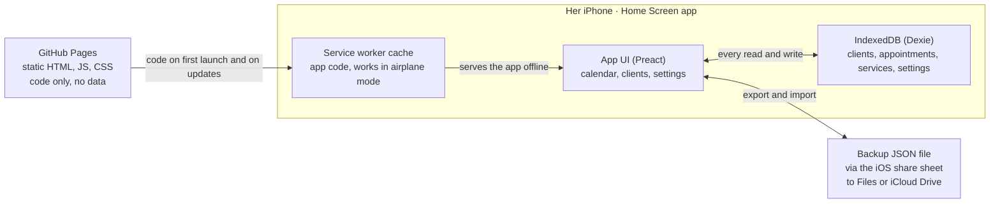

# Kirpėjos užrašų knygelė – App Spec

Spec date: 2026-10-13 · Owner: Tomas

## Purpose and hard constraints

A Lithuanian-language Home Screen web app replaces a hairdresser's paper appointment book. All data stays on her iPhone. One user, one device, no backend.

| Constraint | Rule |
| --- | --- |
| Language | Every visible string is Lithuanian (lt-LT): labels, dates, weekdays, toasts, errors, empty states. 24-hour time. Week starts Monday. |
| Platform | Home Screen web app on iPhone, opened from its icon in standalone mode. No App Store, no Apple Developer account. |
| Hosting | Static files on GitHub Pages. GitHub serves code only and never receives data. |
| Data | IndexedDB on the phone. No server, no analytics, no third-party requests at runtime (no CDN fonts or scripts). |
| Typing | The client name is the only free-text input when booking. Service, date and time are picked. |
| Time | Only the start time is recorded and shown. The user never enters or sees an end time. |
| Speed | A new booking takes at most 3 taps plus typing the name. |
| Look | Feels like a native iOS app (see [iOS look and feel](#ios-look-and-feel)). |

## Platform, hosting and storage

A static PWA built from a GitHub repo and served by GitHub Pages. After the first load a service worker serves the code from cache, and all reads and writes go to IndexedDB on the phone.

GitHub delivers only code. The backup file is the only copy of the data that ever exists off the phone. Nothing flows back to GitHub.

| Component | Choice | Reason |
| --- | --- | --- |
| Build | Vite + TypeScript | Static output that Pages can serve |
| UI | Preact | Small bundle, plain component model |
| Storage | Dexie.js over IndexedDB | Versioned schema with upgrade functions |
| Offline | vite-plugin-pwa (Workbox precache) | App opens in airplane mode |
| Dates | Native `Intl` with `lt-LT` | Lithuanian weekdays and months with no date library |
| Deploy | GitHub Actions to Pages on push to `main` | One-step release |

Rules:

- **Fixed origin and path.** The app lives at `https://flashuu1.github.io/darbo-knyga/` (GitHub Pages project site, repo `flashuu1/darbo-knyga`). The origin `https://flashuu1.github.io` and the path `/darbo-knyga/` are permanent: storage is tied to the origin, so moving the app, renaming the repo or changing the path strands her data. Storage is per origin, not per path, so any other site on the `flashuu1` account shares this origin: the IndexedDB database name must stay unique (the app uses `vizitai`) and no other site may touch it. The production build uses `base: '/darbo-knyga/'` (`site.config.json`, the single source of truth; `scripts/scan-bundle.mjs` fails if `dist/` disagrees); the manifest `start_url`/`scope`, service-worker scope and precache URLs all derive from it. Dev and the e2e build use `/`.
- **Standalone only.** If the app is opened in a Safari tab, it shows only the install screen and never writes data. The Home Screen app's storage is treated as separate from Safari's.
- **Persistence.** Call `navigator.storage.persist()` on the first standalone launch and show the result in Settings.
- **Local wall-clock times.** Store `start` as `YYYY-MM-DDTHH:mm` local time and never convert it to UTC. The DST change on 2026-10-25 must not shift any appointment.
- **Schema changes.** Only through Dexie version upgrades that migrate the data. Never drop a store.
- **Updates.** A new code version activates on the next launch, never while a sheet is open.
- **Backup.** Export all data as one JSON file that includes `schemaVersion`. Share it through the iOS share sheet (`navigator.share` with a file) to Files or iCloud Drive. Import restores it from a file picker.
- **Out of scope:** reminder notifications (need a push server), access to iOS Contacts or Calendar, haptics (iOS Safari has no Vibration API).

## Data model

The app stores four record types. Clients are created automatically from the typed name, so a separate contact form is never needed.

**`clients`**

| Field | Type | Notes |
| --- | --- | --- |
| `id` | string (UUID) | Primary key |
| `name` | string | As typed, trimmed, single spaces |
| `nameKey` | string, indexed | Lowercase with diacritics removed (`NFD`, strip marks): "Žydrūnė" becomes "zydrune" |
| `phone` | string, optional | Added later from the client card, never during booking |
| `createdAt`, `updatedAt` | ISO timestamp | |

**`appointments`**

| Field | Type | Notes |
| --- | --- | --- |
| `id` | string (UUID) | Primary key |
| `kind` | `client` \| `personal` | Personal = her own appointments |
| `clientId` | string, nullable, indexed | Null when `kind = personal` |
| `title` | string, nullable | Typed text for personal entries only |
| `serviceId` | string, nullable | Null when `kind = personal` |
| `start` | string `YYYY-MM-DDTHH:mm`, indexed | Local wall-clock time, any minute (the time wheels are not limited to a grid) |
| `status` | `booked` \| `cancelled` \| `noshow` | "Done" is derived: `booked` with a start in the past |
| `cancelReason` | string, nullable | Always null for new cancellations (no reason is asked); kept for older data |
| `cancelledAt` | ISO timestamp, nullable | |
| `amountCents` | integer, optional | What she took for the visit, in euro cents. Absent or null = not entered yet. Unindexed, so no schema version bump |
| `moves` | array of `{at, from, to}` | Reschedule history, appended on every move |
| `createdAt`, `updatedAt` | ISO timestamp | |

**`services`**: `id`, `name`, `color` (iOS system colour name), `minutes` (hidden default length), `order`, `active`. Removing a service sets `active = false` so old appointments keep their label.

**`settings`** (one record): `dayStart` (08:00), `dayEnd` (20:00), `slotMinutes` (15), `lastBackupAt`, `persistGranted`.

Logic rules:

1. On save, look up the typed name by `nameKey`. If it matches, link the existing client; if not, create a new client.
2. The service's `minutes` is used only to size the block in the calendar and to detect overlaps. It never appears in a booking form (it is edited only in Settings).
3. An overlap means another `booked` appointment whose `[start, start + minutes)` intersects the new one. Overlaps warn but never block the save.
4. Search compares `nameKey` with the folded query. `localeCompare` cannot be used here: under `lt` rules "Z" and "Ž" are different letters.
5. Client lists sort with `Intl.Collator('lt')`.

## Screens and navigation

The app opens on today's day view. A bottom tab bar has three tabs: Kalendorius, Klientai, Nustatymai.

| Screen | Contents | Main gestures |
| --- | --- | --- |
| Calendar – Day (default) | Large title with the date ("spalio 14 d., trečiadienis"). Week strip of 7 day chips, with a dot on days that have bookings. Vertical timeline from `dayStart` to `dayEnd` with 15-minute rows. Each entry shows start time, client name and service, coloured by service. | Swipe left or right to change day. Tap an empty row to book there. Tap an entry to open it. Long-press an entry to move it. "Šiandien" button jumps to today. |
| Calendar – Week | Segmented control "Diena \| Savaitė". Seven columns with compact entries (time + name). | Same as Day. Dragging an entry across columns changes its date. |
| Calendar – Month | Opened by tapping the month name. Month grid with a booking count per day. | Tap a day to open its Day view. |
| Appointment sheet | Bottom sheet: name, service, date and time, status, actions. | See [Open, reschedule and cancel](#open-reschedule-and-cancel). |
| New appointment sheet | Bottom sheet, see [Add appointment flow](#add-appointment-flow). | Opened by "+" in the nav bar or by tapping an empty row. |
| Clients | Search field and alphabetical list (`Intl.Collator('lt')`) with the last visit date under each name. | Tap a client to open the card. |
| Client card | Name (editable), optional phone, upcoming visits, past visits, visit count, cancellation and no-show count. "Registruoti" button. | "Registruoti" opens the new appointment sheet with the client filled in. |
| Settings | Services (add, rename, reorder, colour, length in minutes, hide), working hours, backup export and import, storage status, app version. | |
| Install screen | Shown only when the app is opened in a Safari tab: steps to add it to the Home Screen. | |

## Add appointment flow

A full-height modal with three screens that slide (no layout shift when the keyboard opens: the name field is at the top and only the first screen has a keyboard). Swipe down on its header, or "Atšaukti", closes it.

1. **Klientas.** Segmented control "Klientas | Asmeninis". Autofocused name field (the keyboard opens inside the tap that opened the modal) with the 3 most recent clients while it is empty and diacritic-insensitive matches while typing (max 3). Return ("Toliau") or tapping a client moves on; Enter never saves. Asmeninis: a title field, then straight to Laikas.
2. **Paslauga.** Large service cards (service colour, check mark when selected; default = the client's last active service, otherwise the first), a "Laikas" summary row and "Išsaugoti". No keyboard.
3. **Laikas.** An in-app month calendar (Monday first, dots on days with bookings, swipe or arrows between months) above two scrolling time wheels (hours, minutes; every minute 00–59 can be picked, tapping a number works too). The picked time is stored exactly as picked. It is used everywhere a time is chosen, including "Perkelti".

A new booking from an empty slot takes 3 taps plus typing the name: tap the slot, (type the name, return), tap a service card, tap "Išsaugoti". The first "Išsaugoti" tap on an overlapping time shows "Šiuo laiku jau užregistruota: {vardas} – {paslauga}", the second saves. Every service and personal entry is 15 minutes long by default.

"Užregistruoti į priekį" (appointment sheet and client card) opens the same modal directly on Laikas for the same client and service, with tomorrow at the visit's time of day preselected; there are no 4/6/8-week shortcuts.

## Amounts

When a client visit's start time has passed and no amount is entered, its calendar entry turns orange with "Pridėti sumą". Tapping it opens the "Suma" dialog (number keyboard, euros, comma or dot); "Patvirtinti" stores `amountCents` and the entry then shows e.g. "45,00 €". The amount can be changed or cleared from the appointment sheet (clearing makes the entry orange again). Cancelled, no-show and personal entries never ask for an amount. Reports and totals come later.

## Open, reschedule and cancel

Tap opens an entry. Long-press moves it. Cancel takes two taps and one confirmation; no reason is asked.

**Open (tap).** The appointment sheet shows the name (tapping it opens the client card), the service chips (tapping one changes the service immediately), the date and time, and the status. Actions, top to bottom:

- "Perkelti": opens the date and time wheels, saves when they close.
- "Neatvyko": shown only after the start time has passed. Sets `status = noshow`.
- "Atšaukti vizitą": red, destructive.
- "Atkurti vizitą": shown instead of the two actions above when the entry is cancelled or a no-show.

**Reschedule (long-press and drag):**

1. Hold an entry for 400 ms without moving. The entry lifts (scale 1.03 + shadow) and scrolling locks. Moving more than 8 px before 400 ms is treated as a scroll, not a drag.
2. Drag in any direction: the lifted entry follows the finger and a live label shows the new time (dropped on whole 5 minutes). The day under the finger is highlighted.
3. To change the date in Week view, drag across columns. In Day view, drop on a chip in the week strip (it keeps the time), hold at the left or right screen edge (about 0.4 s, then one day every half second) to flip the day, or hold over the first or last day of the week strip to page to the next or previous week, so any date can be reached.
4. Release to save immediately, append to `moves`, and show the toast "Perkelta: spalio 15 d., kt · 14:00" with "Anuliuoti" for 5 s.
5. Dropping onto an overlap is allowed; the toast adds the overlap warning.
6. While dragging, holding within 40 px of the top or bottom edge of the timeline scrolls it.

**Cancel:**

1. Tap "Atšaukti vizitą".
2. An iOS action sheet titled "Atšaukti vizitą?" offers "Atšaukti vizitą" (red) and "Palikti" (keep). No reason is asked.
3. Set `status = cancelled` with `cancelReason` and `cancelledAt`. Show the toast "Vizitas atšauktas" with "Anuliuoti".
4. The slot is free right away. In the timeline the cancelled entry shrinks to a thin, faded, struck-through line; the rest of its row still books a new visit. Tapping the line offers "Atnaujinti vizitą" (bring it back as it was) or "Pakeisti nauju vizitu" (book something new in its place; the cancelled entry is then removed). Cancelled entries are removed for good after 7 days (checked at launch and whenever the app returns to the front).

Wording: "Atšaukti" means both "cancel" and "undo" in Lithuanian. Undo is always "Anuliuoti" (the iOS term), and cancelling an appointment is always "Atšaukti vizitą", never plain "Atšaukti".

## iOS look and feel

The app copies iOS system patterns rather than inventing its own: large-title nav bar, bottom tab bar, bottom sheets with a grabber, action sheets for destructive choices.

| Area | Rule |
| --- | --- |
| Font | `font: -apple-system-body` on the root, so the app follows her iPhone text-size setting. Sizes in `rem`, never fixed `px` for text. |
| Colour | iOS system palette, light and dark through `prefers-color-scheme`. Each service has one colour, used as the entry's left bar and tint. |
| Shell | Manifest `display: standalone`. `viewport-fit=cover` and `env(safe-area-inset-*)` padding. 180×180 `apple-touch-icon`. `theme-color` and the status-bar style meta tag. |
| Touch | Targets at least 44 × 44 pt. `-webkit-touch-callout: none` and `user-select: none` on entries so long-press never opens the text callout. `overscroll-behavior: none`. No double-tap zoom. |
| Inputs | Font size at least 16 px so iOS does not zoom on focus. Dates and times are chosen in the app's own calendar and time wheels (no native date/time inputs). Working hours use `<input type="time">`, snapped to 15 minutes in code because iOS ignores `step`. |
| Motion | Sheet and push transitions 250–350 ms. Disabled under `prefers-reduced-motion`. |
| Feedback | No haptics are available, so every action shows a visual state change and a toast. |
| Empty states | Plain Lithuanian sentences, for example "Šią dieną vizitų nėra", with one obvious next action. |

## Lithuanian UI strings

All strings live in one file (`src/i18n/lt.ts`), and the UI never uses inline literals. Dates and weekdays are formatted only with `Intl.DateTimeFormat('lt-LT')`, which gives "spalio 14 d., trečiadienis" and the short forms pr, an, tr, kt, pn, št, sk. Counted nouns use `Intl.PluralRules('lt')` (categories one, few, many, other), or a label that avoids the plural, such as "Vizitų skaičius: 5".

| Key | Lithuanian | Where |
| --- | --- | --- |
| `tab.calendar` | Kalendorius | Tab bar |
| `tab.clients` | Klientai | Tab bar |
| `tab.settings` | Nustatymai | Tab bar |
| `view.day` / `view.week` / `view.month` | Diena / Savaitė / Mėnuo | Calendar view switch |
| `nav.today` | Šiandien | Calendar nav bar |
| `sheet.new.title` | Naujas vizitas | New appointment sheet |
| `type.client` / `type.personal` | Klientas / Asmeninis | Type segment |
| `field.name` | Kliento vardas | Name placeholder |
| `field.title` | Pavadinimas | Personal entry placeholder |
| `field.service` | Paslauga | Section label |
| `field.time` | Laikas | Section label |
| `btn.save` | Išsaugoti | Sheet nav bar |
| `btn.dismiss` | Atšaukti | Sheet nav bar (closes without saving) |
| `btn.close` | Uždaryti | Appointment sheet |
| `act.move` | Perkelti | Appointment sheet |
| `act.noshow` | Neatvyko | Appointment sheet |
| `act.cancelAppt` | Atšaukti vizitą | Appointment sheet, destructive |
| `act.restore` | Atkurti vizitą | Cancelled or no-show entry |
| `cancel.question` | Atšaukti vizitą? | Action sheet title |
| `cancel.keep` | Palikti | Action sheet |
| `status.booked` | Užregistruota | Status label |
| `status.done` | Įvyko | Derived status label |
| `status.cancelled` | Atšaukta | Status label |
| `status.noshow` | Neatvyko | Status label |
| `toast.moved` | Perkelta: {data} · {laikas} | After a move |
| `toast.cancelled` | Vizitas atšauktas | After a cancel |
| `toast.undo` | Anuliuoti | Toast button |
| `warn.overlap` | Šiuo laiku jau užregistruota: {vardas} – {paslauga} | Save or drop over a booking |
| `empty.day` | Šią dieną vizitų nėra | Empty day |
| `clients.search` | Ieškoti | Clients search field |
| `client.upcoming` | Būsimi vizitai | Client card |
| `client.past` | Ankstesni vizitai | Client card |
| `client.book` | Registruoti | Client card button |
| `client.phone` | Telefonas | Client card |
| `settings.services` | Paslaugos | Settings |
| `settings.hours` | Darbo laikas | Settings |
| `settings.backup` | Atsarginė kopija | Settings section |
| `backup.export` | Eksportuoti duomenis | Settings |
| `backup.import` | Atkurti iš failo | Settings |
| `storage.persistent` | Duomenys apsaugoti nuo išvalymo | Settings, persist granted |
| `storage.notPersistent` | Duomenys gali būti išvalyti – sukurkite atsarginę kopiją | Settings, persist denied |
| `install.title` | Įdiekite programėlę pagrindiniame ekrane | Install screen |

Default services, all editable in Settings: Kirpimas, Dažymas, Kirpimas ir dažymas, Sruogelės, Šukuosena, Kita. The install screen's step text must quote the Share-menu label exactly as it reads on her iPhone, checked on the device.

## Suggestions

Seven additions ranked by value. Numbers 1–3 belong in the first testable version; the rest can follow.

| # | Suggestion | What it does | Why |
| --- | --- | --- | --- |
| 1 | Backup reminder | If `lastBackupAt` is older than 7 days, Settings shows a badge and the day view shows a one-line banner "Sukurti atsarginę kopiją?" that opens the share sheet. | Phone storage is the only copy. This is the cheapest protection against eviction, a lost phone or a wiped app. |
| 2 | One-tap rebooking | A "Kartoti" action on an appointment and on the client card, with chips "po 4 sav.", "po 6 sav.", "po 8 sav.". It opens the new sheet with the same client and service at that interval. | Hair clients come back on a cycle, so the next booking is usually made in the chair. (Now "Užregistruoti į priekį": opens the calendar picker, no fixed 4/6/8-week chips.) |
| 3 | Smart defaults | The client's last service is preselected, the next free slot is suggested, and recent clients appear before typing. | Shrinks most bookings to a tap on a name and "Išsaugoti". |
| 4 | Free-slot highlight | Gaps between bookings are tinted in the day view. A slot freed by a cancellation pulses briefly. | She can answer "when do you have time?" on the phone at a glance. |
| 5 | Phone, call and SMS | An optional phone number on the client card, with `tel:` and `sms:` buttons. Never asked during booking. | One tap to confirm a booking or offer a freed slot. |
| 6 | Reliability marker | The client card and the name suggestions show cancellation and no-show counts, for example "Atšaukė: 3". | Helps her decide who to double-check before holding a prime slot. |
| 7 | Paper-book import | A one-time CSV import (`data,laikas,vardas,paslauga`) in Settings, so the future bookings already in the paper book can be loaded on day one. | Going live without retyping weeks of bookings on the phone. |

## Open decisions

These need an answer before the build starts. The spec uses the default shown until each is decided.

| Decision | Default in this spec |
| --- | --- |
| App name on the Home Screen | "Vizitai" |
| Final service list and the hidden length of each | The 6 defaults above, 30–120 min |
| Working hours shown in the day view | 08:00–20:00, 15-minute grid |
| Origin | Decided by the owner: `https://flashuu1.github.io`, fixed path `/darbo-knyga/` (project site). Never change either; other sites on this account share the origin, so keep IndexedDB names unique (`vizitai`) |
| Her iPhone's iOS version and system language | iOS 26, Lithuanian, so the native date wheels are also in Lithuanian |
| Cancelled entries in the timeline | A thin, faded, struck-through line |
| Overlapping bookings | Warn and allow |

## Acceptance criteria and test plan

The first testable build is accepted when every item below passes on a real iPhone running the app from its Home Screen icon. Automated checks run in Playwright with the WebKit engine and iPhone device emulation. The on-device checks are done by hand.

Automated (Playwright, WebKit, iPhone viewport):

- [ ] Booking from an empty slot takes 3 taps plus typing the name.
- [ ] Searching "zydrune" finds "Žydrūnė", and typing an existing name links that client instead of creating a duplicate.
- [ ] The client list sorts with `Intl.Collator('lt')`.
- [ ] A long-press drag follows the finger freely, drops on whole 5 minutes, changes the date in Week view and via the week strip, and is undone by "Anuliuoti".
- [ ] A quick swipe under 400 ms scrolls the timeline and never starts a drag.
- [ ] Cancelling takes one confirmation (no reason), the freed slot accepts a new booking, and "Anuliuoti" restores the original.
- [ ] An appointment at 10:00 on 2026-10-25 (the DST change) still shows 10:00.
- [ ] Export, clear the data, then import gives identical record counts and contents.
- [ ] A schema version bump with seeded data loses no records.
- [ ] A scan of the built bundle finds no visible English strings outside `lt.ts`.

On the device (by hand):

- [ ] Installs to the Home Screen and opens full-screen, respecting safe areas, in both light and dark mode.
- [ ] Opens and works in airplane mode after the first launch.
- [ ] Data survives closing the app, restarting the phone, and deploying a new code version.
- [ ] Settings shows the result of the storage persistence request.
- [ ] Remains usable at the largest iOS text size.
- [ ] Long-press never opens the iOS text callout or the magnifier.

## Contacts (Klientai) and payments

The list is ordered by what needs her attention:
1. **Waiting for an amount** (orange "Pridėti sumą"): clients with a visit whose time has passed and no amount yet, the longest-waiting first.
2. **Paid this month** (green "✓ Sumokėta 45,00 €"): the sum of the amounts entered for visits in the current month. It shows until the end of the month; on the 1st the row falls back to the next visit, or nothing.
3. **Coming visit** ("Kitas vizitas: …"), soonest first.
4. Everybody else, A–Z with Lithuanian rules.
A client can show several of these at once (for example paid and a next visit). In the calendar, an entry with an amount is green with "✓ 45,00 €"; one waiting for an amount is orange.

## Name suggestions

While typing a name (from the first letters; "contains" matches from 2 letters) the suggestions are ranked: names starting with the text, then names where a later word starts with it, then names containing it; inside each rank, the client she books most, then the most recent. At most 5 are shown.

## Service lengths

Every service defaults to 15 minutes; the length is edited per service in Nustatymai → Paslaugos and is remembered. A one-time migration (schema v2) turned the old built-in lengths (45/90/120/120/60/30) into 15; lengths she set herself are kept.

## Swipes, zoom and deleting

- **Delete by swiping.** In Klientai and in Nustatymai → Paslaugos, swiping a row to the left reveals a red trash button. A client is deleted after a confirmation, together with their visits (the toast offers "Anuliuoti"). A service that visits still use is only hidden (their labels must not vanish); the last active service cannot be deleted.
- **Cancelled visits in Klientai.** Cancelled visits that have not yet been removed (7 days) are listed under "Atšaukti vizitai" at the bottom; tapping one offers "Atnaujinti vizitą", "Pakeisti nauju vizitu" or "Ištrinti visam laikui".
- **Status.** A visit reads "Laukiama" while it is ahead, "Nepatvirtinta" once its time has passed without an amount, "Įvyko" once the amount is in; cancelled and no-show are "Atšaukta" / "Neatvyko".
- **Main button of the booking flow** ("Toliau" / "Išsaugoti") is at the bottom of every screen and rides up above the keyboard while it is open.
- **Sheets** (visit, move) close by swiping down from anywhere on them while their content is not scrolled, or from the handle.
- **Zoom.** Two fingers on the timeline (Diena and Savaitė): like a map: fingers apart make the hours bigger, fingers together show more of the day; the zoom is remembered and the time between the fingers stays put. Zoomed far out, a whole working day fits on one screen, and only every 2nd, 3rd (or more) hour gets a label and a line, with the half-hour and quarter lines dropped first. Switching Diena and Savaitė keeps the same hours in view and slides the grid over.
- **Motion.** Swiping sideways on the timeline slides the day/week with the finger and glides to the next one; switching Diena/Savaitė/Mėnuo eases the new view in; the empty-day message fades out by itself and as soon as the calendar is scrolled.

## Personal entries, expenses and the balance

- **Her own choices (Nustatymai).** Two lists, edited like Paslaugos: "Asmeniniai" (the kinds of personal entry, e.g. Pietūs, Pertrauka, Gydytojas) and "Išlaidų rūšys" (the kinds of expense, e.g. Medžiagos, Nuoma, Mokesčiai). Rename in place, add, swipe left to delete (with Anuliuoti). Stored in the `options` store (`id, group, order`; schema v3). They start empty: there are no templates, she creates them herself (schema v4 removed the examples v3 first shipped with). Part of the backup file; an older file without them has none. Entries keep the name they were made with, so deleting a choice never changes them.
- **New entry.** The first screen has three types: Klientas, Asmeninis, Išlaida. Asmeninis and Išlaida show her list to pick from (no typing); Išlaida also asks for the amount. Then Laikas, then save. An expense is an entry of kind `expense` (title = the choice, `amountCents` = money out), shown in the calendar in red as "−12,50 €", opened and moved like any entry, and its amount can be changed. It never raises an overlap warning.
- **Balance.** Shown under the title on every calendar view: money in (amounts of visits) minus money out (expenses), all time, with "Gauta" and "Išlaidos" beside it. Cancelled and no-show entries do not count. It can go negative (red). Budgeting and reports come later.
- **Name suggestions with the keyboard up.** The first screen shrinks to the part above the keyboard and the main button, so every suggestion that fits is visible and the list scrolls on its own; dragging the list puts the keyboard away. Up to 8 suggestions.
- **An expense is not a visit.** Its sheet shows only the amount (change), Perkelti (date and time) and Ištrinti išlaidą (with Anuliuoti); no status, cancel, no-show or restore. It is red, never the green of a paid visit.
- **Išlaidos tab** (fourth tab): one month at a time (arrows), that month's money in, expenses and balance, the expenses per kind, and every expense entered, newest first; a tap opens it.

## Performance rules

- **Scrolling never waits for JavaScript.** Touch listeners on scrolling areas are passive. The one exception is the two-finger zoom of the timeline: its non-passive `touchmove` listener exists only while two fingers are down. The timeline scroller has `touch-action: pan-y`.
- **Animate only `transform` and `opacity`** (compositor), never `top`, `bottom`, `height` or `width`. No `backdrop-filter` over scrolling content.
- **Do not re-render what did not change.** A live query that returns the same data keeps the previous value (no render). The 15-minute rows of a column are a memoised component. Entries and clients are read in one IndexedDB transaction.
- **The calendar stays mounted** behind the other tabs, so coming back is instant and keeps the scroll position and zoom. Each calendar column uses `contain: layout style`.

- **Suma sheet.** Opens the number pad (the hidden keyboard primer is switched to `inputmode=decimal` inside the tap), and its confirm button is a full-width bar at the bottom of the screen that rides above the keyboard, like the booking flow. The header keeps Atšaukti and the link to the visit.

## Product direction (the master picture; not a build list)

This is the direction every feature is measured against. Nothing in this section is built on request; it is what we keep getting closer to.

- **A personal assistant, not a notebook.** She does the work; the app keeps the books. Whatever she enters once is used everywhere after it: the calendar, the clients, the money, what needs doing next. Over time the app takes over more by itself (suggesting and eventually making bookings, reminding, noticing who is overdue), while entry stays manual until the client base is built up.
- **A tool she relies on, and her clients rely on.** It replaces the paper notebook completely, and becomes where a client's history, purpose, timing and payments live. Later it can show clients when she is free (see "calendar availability" below).
- **A minute at the end of the day.** She glances at it between clients and does the books at the end of the day. Booking takes at most a minute; everything that can be worked out must already be worked out when she opens it, so the numbers are accurate without her chasing them: what is waiting for an amount, who should be booked again, what the day brought in and cost.
- **Insights over time.** With many clients and years of entries it must answer questions (who is regular, who has gone quiet, what earns, what costs, how the months compare). That needs queue, filtering and smart indexing, which we revisit once the data is there.
- **Rules that follow from it:** never make her enter the same thing twice; prefer defaults and one-tap choices to typing; anything waiting for her attention is visible at a glance (orange glow, pills in Klientai); every flow keeps its main action in the thumb zone; performance and smoothness are a prerequisite for every feature.
- **Possible later steps** (hypothetical): public availability, self-booking with her approval, automatic suggestions for rebooking. These need a backend, which would change the "no network, one device" rule and the privacy position; decide together before building.

## Orange glow and settling up

- A visit whose time has passed and that has no amount yet glows orange (a soft pulsing ring with two small sparks) in Diena and Savaitė; it stops the moment the amount is in. Only opacity and transform animate. Reduced-motion users get a still ring.
- In Klientai the orange "Pridėti sumą" pill opens Suma for that client's longest-waiting past visit directly, without opening the client card.
- The first amount of a client visit is followed by "Užregistruoti dar kartą?" in the same sheet: the blue "Taip, užregistruoti" button sits where "Patvirtinti" was (the number pad stays up, so nothing moves), "Ne" closes with Anuliuoti available. Taip opens the date and time picker for the same client and service (tomorrow at the same time preselected), and saving shows that day in the calendar. Changing or clearing an existing amount asks nothing.

## Nustatymai layout

Nustatymai is a list of categories like iOS Settings, in three groups: Kalendorius (Paslaugos, Darbo laikas), Pasirinkimai (Asmeniniai, Išlaidų rūšys), Duomenys (Atsarginė kopija with a red dot when one is due, Apie programą with storage, version and build). Each row shows a coloured icon, its name and a short value, and opens its own page that slides in from the right, with a back button named Nustatymai, a large title, and a swipe from the left edge to go back. The build id also shows under the list.

## Išlaidos tab: positive first

Money in leads and money out is calm. The tab opens with the month's balance ("Liko šį mėnesį", green when positive, red only when the month is negative) and a legend with Gauta (green) and Išlaidos (indigo, never red). Below: a chart with one column per day, money in above the line and money out below it (colour is never the only cue), where a finger dragged across reads any day; "Kas sumokėjo", round dots with initials for the clients who paid this month, largest first (a tap opens the client); the expenses per kind as share bars; and every expense. Expense entries in the calendar are indigo/neutral for the same reason.

- **Motion budget.** Press 90 ms, fast 150 ms, medium 220 ms, sheets 320 ms; nothing longer than half a second. Animated properties are transform and opacity (colour fades only on small controls); a layer (`will-change`) exists only while something moves. With iOS Reduce Motion on, everything is reduced to ~1 ms. A page-level touch listener makes iOS show the pressed look (`:active`) at once. `tests/e2e/animations.spec.ts` watches every animation and transition during a tour of the app and fails on layout-forcing properties or anything over 500 ms.

## Entries, taps and settling up (overhaul)

- **The entry sheet** is laid out in blocks: who and when (avatar with initials, name linking to the client card, date · service · minutes, a status pill); the service chips; the money (a big orange "Pridėti sumą" button while the amount is missing, a green tick row with the amount and "Keisti sumą" once it is in); then the actions as full-width icon rows (Perkelti, Užregistruoti į priekį, Skambinti when the client has a phone number); and the risky ones in their own group below (Neatvyko, Atšaukti vizitą; an expense gets Ištrinti išlaidą).
- **A tap just beside an entry opens the entry.** A finger is bigger than a thin entry. A tap on an empty row that lands within 14 px sideways or 9 px above/below an entry opens that entry instead of booking a new one beside it (it re-uses the entry's own tap, so a due visit still raises the number pad). A tap farther away books as before.
- **Settling up in as few presses as possible.** Tap the entry (or the orange pill in Klientai), tap one of the amounts this client paid before (or type one), Patvirtinti, then the question. The amount is followed by a short confetti burst and a tick; "Ne" is a clearly outlined button next to the blue "Taip, užregistruoti".

- **What an entry shows depends on its own height**, not on the zoom of the whole calendar (`logic/fit.ts`, `data-fit` on the entry): the whole card from 54 px (40 px for a one-line entry); time and name on one line from 30 px; the name alone from 12 px; below that only the colour. A long visit therefore keeps its name when the calendar is zoomed out, in Diena and in Savaitė; a quarter of an hour at the smallest zoom is a sliver with no room for text.

## Vestuvės is a service (flowers)

Vestuvės is one of the services in Paslaugos (pink, 4 hours to start from, listed before Kita; schema v5 adds it once to an existing install). A service can carry the "Gėlių efektas" switch (Nustatymai > Paslaugos): visits of such a service get flowers drifting up from the entry while the visit is coming up and while it waits for its payment (on top of the orange glow once the time has passed), and none once the amount is in or the visit is cancelled. Vestuvės has the switch on; any service can be given it. Service lengths go in quarter hours up to 2 hours and in half hours after that, up to 14 hours, so a wedding can be as long as it needs to be.

- **The glow and the flowers scale with the entry.** Both are layers exactly the size of the entry, and the ring, blur, sparks and flowers are sized from that layer's own height (container query units), so they follow the pinch live and are there at every zoom (a long visit gets big soft flowers, a quarter-hour sliver gets small ones). They are hidden only with Reduce Motion.

## Suvestinė: day, week and month

The calendar header carries one quiet button, "Dienos suvestinė" / "Savaitės suvestinė" / "Mėnesio suvestinė" according to the view (Diena, Savaitė, Mėnuo), with an orange badge for how many client visits anywhere still wait for their amount. It opens the books of what is on screen: the money (in, out, net) and a progress bar ("Sumokėta 2 iš 5"); the visits waiting for their amount, each with the amounts this client paid before as one-tap chips (a tap records the amount at once, with Anuliuoti) and "Kita suma" (opens Suma and returns to the page); when the period contains today also the earlier visits that never got an amount; the paid ones (a week or month lists the newest 30) each with "Užregistruoti dar kartą"; how many visits are still to come. Settling the last waiting visit shows "Viskas suvesta!" with confetti. A day is never a future day. The all-time balance is no longer shown on the calendar.

## Changing an amount

A confirmed amount that is changed leaves a line on the visit (`amountLog`: when, from, to), shown newest first as "Sumos pakeitimai" in the entry sheet; Anuliuoti removes the line with the change. Entering 0 (or nothing) on a visit that has an amount asks "Nunulinti sumą?" and explains that the visit becomes "Nepatvirtinta" and waits for its amount again; on agreeing the amount is removed (not stored as 0) and the log says it was nulled. 0 as a first amount is refused (nothing to reset).

## Asmeninis (overhaul)

- **Common words from the start** (hers to rename, add to or delete in Nustatymai > Asmeniniai): Psichologas, Psichiatras / psichiatrė, Neurologas / neurologė, Daktaras, Šeimos gydytojas, Dantistas, Akių gydytojas, Kineziterapeutas, Masažas, Pietūs, Autoservisas, Bankas (Pertrauka and Vaikų reikalai were taken out again; schema v7 removes them from an install that got them). A fresh install is seeded with them; schema v6 adds them once to an existing install (a word she already has is not doubled, her own stay first). Išlaidų rūšys still starts empty.
- **Half an hour by default**, and each choice has its own length (Nustatymai > Asmeniniai, quarter hours up to 2 hours, then half hours); a personal entry takes the length of its choice when it is made (`durationMinutes`). Entries made before this are half an hour too.
- **Its own colour**: teal, in the calendar and in the entry sheet (grey meant "nothing").
- **The time wheels are loose.** Snapping stays, but nothing forces a stop at every number (`scroll-snap-stop: normal`), so a fling with speed carries on and settles by itself, and the number under the bar lights up while the wheel still turns.

- **The choices are cards, not rows** (Asmeninis and Išlaidos in the booking flow): two to a row, each with a picture on its own colour (guessed from the word by `logic/glyph.ts`: psichologas a brain, daktaras a stethoscope, dantistas a tooth, nuoma a house ...; a word it does not know gets its first letter on a colour that stays the same), a soft gradient of that colour, and a circle in the corner that fills in the card's colour with a ring around the card when it is picked.
